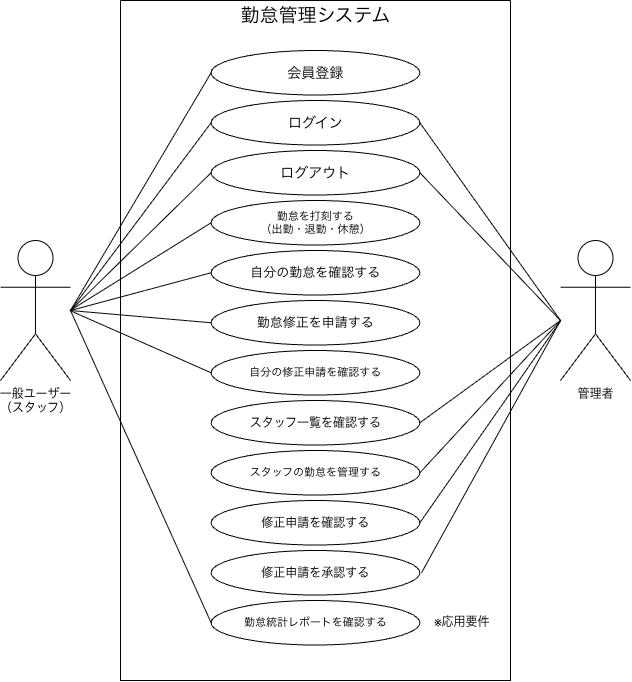
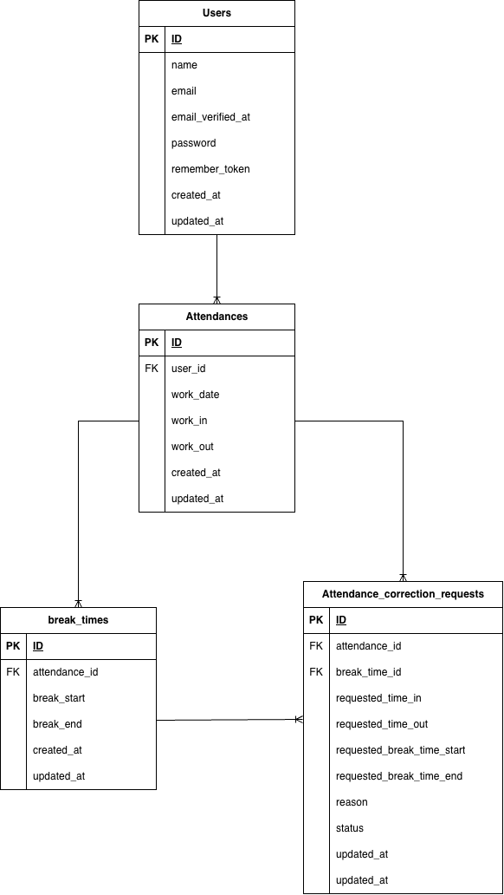
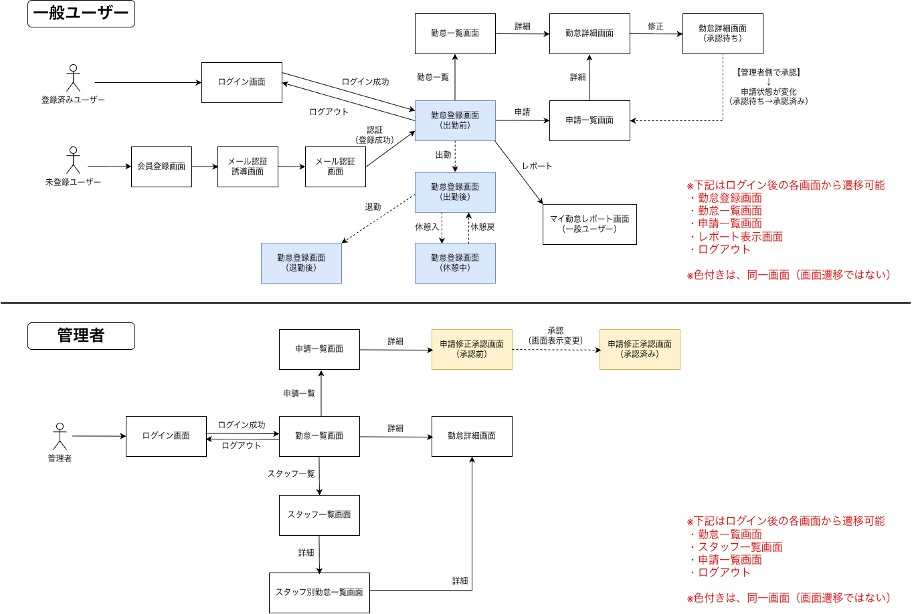

# attendance-app

<div align="right">
<p><strong>開発者：鴨志田 悟</strong></p>
<p><strong>開発開始日：2026年9月18日</strong></p>
<p><strong>開発完了締切日：2026年11月2日</strong></p>
</div>

## 概要

**従業員の出退勤・休憩時間を管理するWebアプリケーションです。**

#### 従業員（一般ユーザー）の機能

- ユーザー登録（名前・メールアドレス・パスワード）：メール認証
- ログイン入力（メールアドレス・パスワード）
  [!IMPORTANT]以下、ログイン後
- 出勤・退勤・休憩の打刻
- 勤怠一覧・詳細の確認
- 勤怠情報の修正申請
- マイ勤怠レポート（過去６ヶ月の勤怠統計）の確認

#### 管理人の機能

- ログイン入力（メールアドレス・パスワード）
  [!IMPORTANT]以下、ログイン後
- スタッフ別勤怠一覧、詳細の確認
- スタッフ一覧の確認
- 従業員の勤怠修正（直接入力）
- 従業員からの修正申請承認
- 従業員毎・該当月の勤怠一覧のCSV出力

#### その他の機能

外部アプリケーションから勤怠データを取得・操作可能なAPIエンドポイントを公開しております。
| 機能 | URI | 認証 | 認可 |
| ---------- | --------------------- | ---------------- | ---------------- |
| 勤怠一覧取得 | /api/v1/attendance-records | - | - |
| 勤怠詳細取得 | /api/v1/attendance-records/{attendanceRecord} | - | - |
| 勤怠新規登録 | /api/v1/attendance-records | Sanctum | - |
| 勤怠の更新 | /api/v1/attendance-records/{attendanceRecord}| Sanctum | AttendanceRecordPolicy |
| 勤怠の削除 | /api/v1/attendance-records/{attendanceRecord}| Sanctum | AttendanceRecordPolicy |

## 使用技術

- PHP 8.2.35
- Laravel 10.x
- MySQL 8.4
- Nginx
- Vite
- Docker
- Laravel Sail
- phpMyAdmin
- mailpit
- Fortify<br>

[!IMPORTANT]※PHP脆弱性対策に伴い、PHPバージョンを更新致しました(PHP8.2→PHP8.2.35)。※コーチ確認済み<br>
下記の環境構築に同内容を反映しております。

## 提供ファイル（blade/css）の修正点（コーチにご確認・了承済み）

#### old()ヘルパーの適用(blade)

バリデーションエラー時に入力フォームに入力値を残し、UXを向上させる目的でold()ヘルパーの適用をコーチに相談致しました。<br>
本課題においてバックエンド修正が原則の反面、old()ヘルパーはLaravelにて推奨されるblade側の機能の為、コーチよりご許可頂きました。<br>
変更箇所は下記の通りで、valueにold()ヘルパーを適用しております。<br>

user-login.blade.php：メールアドレス（16行目）<br>
user-detail.blade.php：出勤（38行目）、退勤（40行目）、休憩開始（57行目、75行目）、出勤戻（59行目、77行目）、備考（91行目）<br>
admin-login.blade.php：メールアドレス（31行目）<br>
admin-detail.blade.php：出勤（35行目）、退勤（38行目）、休憩開始（64行目、83行目）、出勤戻（67行目、85行目）、備考（99行目）<br>

#### 管理者側申請詳細画面における休憩開始の表示に関する修正(blade)

申請された休憩開始時刻（break_in）がNULLの場合、休憩開始時刻の入力欄に意図せず現在時刻が表示される事象が発生致しました。<br>
原因は、Carbonがnullを現在時刻として扱う事が原因でございます。<br>
従い、コーチへ相談し、NULL=空欄を明示する下記の形へ変更する許可を頂きました。<br>

該当箇所：admin-application-detail.blade.php：45行目<br>

- 変更前

```php
value="{{ \Carbon\Carbon::parse($break->break_in)->format('H:i') }}"
```

- 変更後

```php
value="{{ $break->break_in ? \Carbon\Carbon::parse($break->break_in)->format('H:i') : '' }}"
```

#### 管理者ログイン画面のヘッダーに関する修正(CSS)

変更箇所：admin-login.css(10行目)<br>

```css
max-width: 1540px;
```

変更内容：削除<br>
変更理由：他のページではcommon.cssにてheaderはwidth:100%に設定されているが、管理者ログイン画面のみ、<br>
header幅の設定が重複しており、それが原因でheaderが途切れてしまう為。

## ログイン情報

|            | メールアドレス    | パスワード | ユーザー種別 |
| ---------- | ----------------- | ---------- | ------------ |
| ユーザー１ | user1@example.com | password   | 一般ユーザー |
| ユーザー２ | user2@example.com | password   | 一般ユーザー |
| ユーザー３ | user3@example.com | password   | 管理者       |

## 画面一覧（動作確認用）

| 画面ID | 画面名称                             | パス                                                                              |
| ------ | ------------------------------------ | --------------------------------------------------------------------------------- |
| PG01   | 会員登録画面（一般ユーザー）         | http://localhost/register                                                         |
| PG02   | ログイン画面（一般ユーザー）         | http://localhost/login                                                            |
| PG03   | 勤怠登録画面（一般ユーザー）         | http://localhost/attendance                                                       |
| PG04   | 勤怠一覧画面（一般ユーザー）         | http://localhost/attendance/list                                                  |
| PG05   | 勤怠詳細画面（一般ユーザー）         | http://localhost/attendance/detail/{id}                                           |
| PG06   | 申請一覧画面（一般ユーザー）         | http://localhost/stamp_correction_request/list                                    |
| PG07   | ログイン画面（管理者）               | http://localhost/admin/login                                                      |
| PG08   | 勤怠一覧画面（管理者）               | http://localhost/admin/attendance/list                                            |
| PG09   | 勤怠詳細画面（管理者）               | http://localhost/admin/attendance/{id}                                            |
| PG10   | スタッフ一覧画面（管理者）           | http://localhost/admin/staff/list                                                 |
| PG11   | スタッフ別勤怠一覧画面（管理者）     | http://localhost/admin/attendance/staff/{id}                                      |
| PG12   | 申請一覧画面（管理者）               | http://localhost/stamp_correction_request/list                                    |
| PG13   | 修正申請承認画面（管理者）           | http://localhost/stamp_correction_request/approve/{attendance_correct_request_id} |
| PG14   | マイ勤怠レポート画面（一般ユーザー） | http://localhost/attendance/report                                                |

## 環境構築

### 1. Laravelプロジェクトの作成

作業ディレクトリを作成後、Laravel 10.xを指定してプロジェクトを作成

```bash
docker run --rm \
  -u "$(id -u):$(id -g)" \
  -v "$(pwd):/var/www/html" -w /var/www/html \
  -e COMPOSER_CACHE_DIR=/tmp/composer_cache \
  laravelsail/php82-composer:latest \
  composer create-project laravel/laravel:^10.0 attendance-app
```

### 2. Laravel Sailの導入

MySQL/mailpitを指定してSailの設定ファイルをパブリッシュ

```bash
docker run --rm -u "$(id -u):$(id -g)" -v "$(pwd):/var/www/html" -w /var/www/html \
  laravelsail/php82-composer:latest \
  php artisan sail:install --with=mysql,mailpit
```

**※エイリアスの設定・アプリケーションキーの生成**<br>

1. Sailをバックグラウンドで起動<br>

```bash
./vendor/bin/sail up -d
```

2. エイリアスを設定して 'sail' だけでコマンドを実行できるようにする

```bash
echo "alias sail='[ -f sail ] && bash sail || bash vendor/bin/sail'" >> ~/.zshrc
```

3. アプリケーションキーの生成

```bash
sail artisan key:generate
```

### 3. .env ファイルの設定確認

.envファイルが下記と一致している事を確認する。

```text
DB_CONNECTION=mysql
DB_HOST=mysql
DB_PORT=3306
DB_DATABASE=laravel
DB_USERNAME=sail
DB_PASSWORD=password

MAIL_MAILER=smtp
MAIL_HOST=mailpit
MAIL_PORT=1025
```

### 4. PHP / Laravel / MySQLのバージョン確認

確認方法

```bash
sail php --version
sail artisan --version
sail mysql --version
```

> ⚠️ 技術スタックが指定と異なった為、下記要領にてPHPを変更

compose.yamlを確認<br>
↓<br>
PHP 8.5 → 8.2.35<br>
↓<br>
Dockerイメージを再ビルド<br>

```bash
sail down
sail build --no-cache
sail up -d
```

↓<br>
バージョン確認<br>

### 5. データベース接続確認

LaravelからMySQLへ接続できることを確認します。

```bash
sail artisan migrate --seed
```

### 6. phpMyAdminの設定

phpMyAdminをDocker Composeに追加し、ブラウザからMySQLデータベースを確認

**追加したコード（MySQLと同じインデントへ）**

```yaml
phpmyadmin:
    image: "phpmyadmin:latest"
    ports:
        - "${FORWARD_PHPMYADMIN_PORT:-8080}:80"
    environment:
        PMA_HOST: mysql
        PMA_USER: "${DB_USERNAME}"
        PMA_PASSWORD: "${DB_PASSWORD}"
    networks:
        - sail
    depends_on:
        - mysql
```

### 7. フロントエンド環境

#### Viteの起動

1. NPM依存パッケージのインストール

```bash
sail npm install
```

2. vite開発サーバーの起動
    > ⚠️ 注意点：CSS・JavaScriptなどのフロントエンド処理が発生する場合に、別のターミナルで起動する。

```bash
sail npm run dev
```

#### 提供bladeを移入し、vite.config.jsを下記に置き換える。

```js
import { defineConfig } from "vite";
import laravel from "laravel-vite-plugin";

export default defineConfig({
    plugins: [
        laravel({
            input: [
                "resources/js/app.js",
                "resources/css/sanitize.css",
                "resources/css/common.css",
                "resources/css/auth/verify-email.css",
                "resources/css/user/register.css",
                "resources/css/user/user-login.css",
                "resources/css/user/attendance-register.css",
                "resources/css/user/user-attendance-list.css",
                "resources/css/user/user-detail.css",
                "resources/css/user/user-application-list.css",
                "resources/css/admin/admin-login.css",
                "resources/css/admin/admin-attendance-list.css",
                "resources/css/admin/admin-detail.css",
                "resources/css/admin/admin-application-list.css",
                "resources/css/admin/admin-application-detail.css",
                "resources/css/admin/staff-list.css",
                "resources/css/admin/staff-attendance-list.css",
                "resources/css/reports/index.css", // ※ 応用（マイ勤怠レポート）用。
            ],
            refresh: true,
        }),
    ],
});
```

#### Bladeファイルの配置

提供されたBladeファイルをクローンして、デフォルトのresourcesディレクトリへ置換する<br>
指定開発フローに従い、下記の順番でクローン→置換<br>

1. 基本機能実装時

```bash
git clone -b basic <提供リポジトリURL>
```

2. 応用機能実装時

```bash
git clone -b advanced <提供リポジトリURL>
```

### 8. 動作確認

下記のローカル開発環境URLを入力し、ブラウザよりアクセス。<br>

| サービス   | URL                   | 用途             |
| ---------- | --------------------- | ---------------- |
| Laravel    | http://localhost      | アプリケーション |
| phpMyAdmin | http://localhost:8080 | データベース管理 |
| Mailpit    | http://localhost:8025 | メール確認       |

## ユースケース図



## ER図



## 画面遷移図


